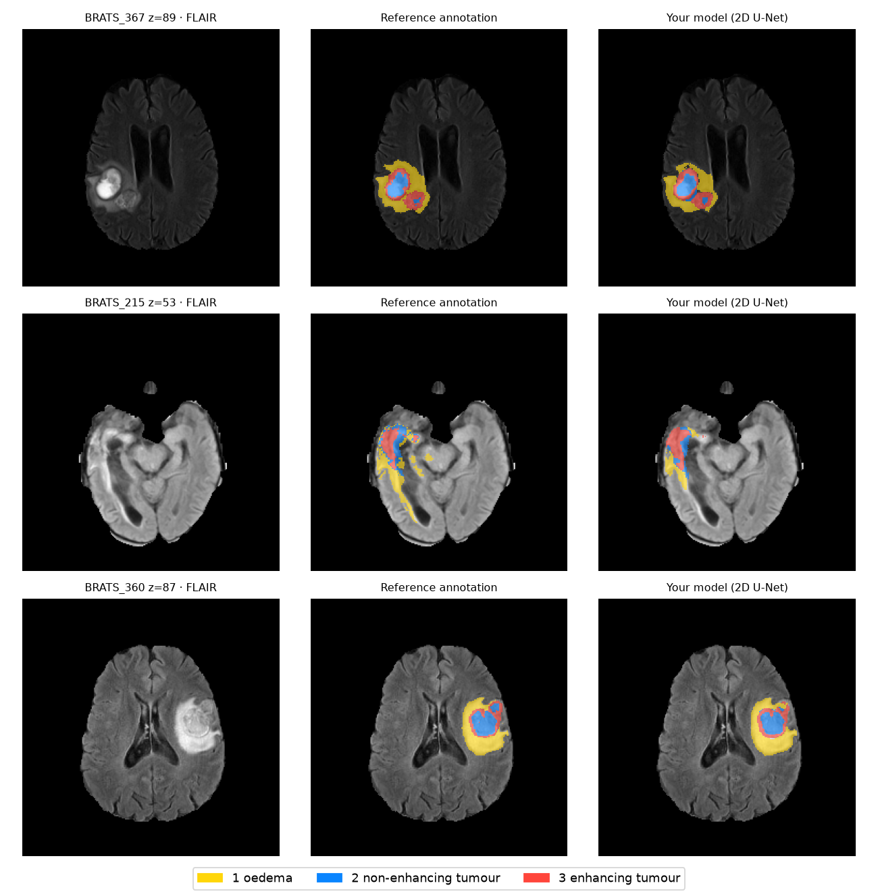
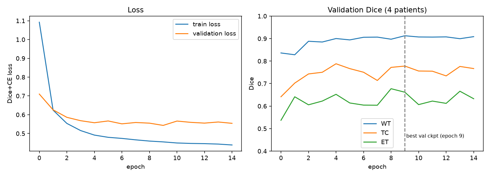
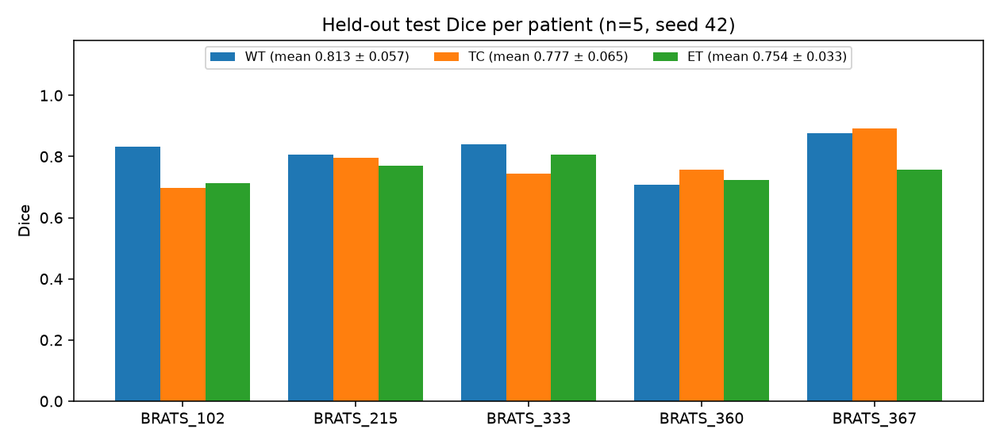
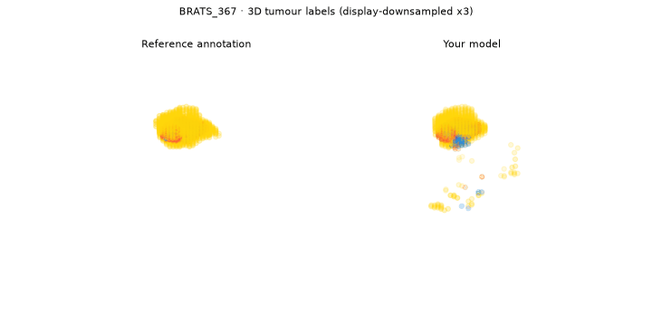
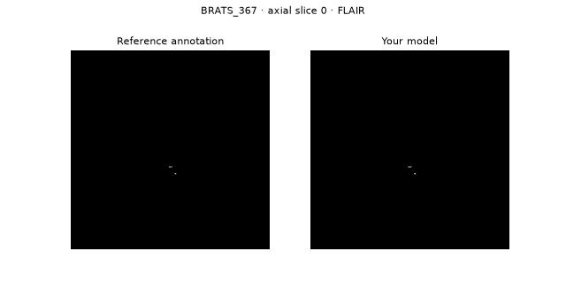
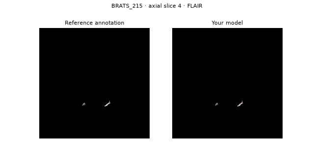
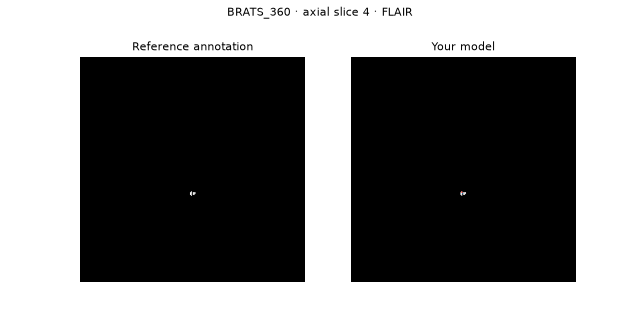
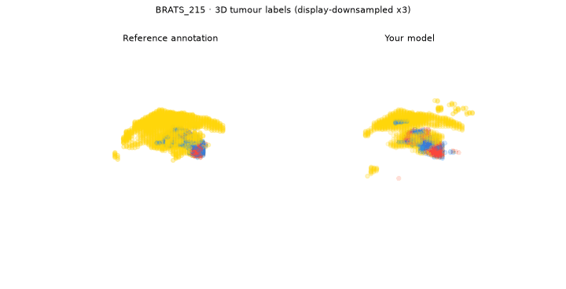
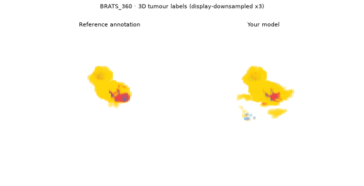

# 3D Brain Tumour Model

> Educational research prototype using de-identified research data. **Not a medical device**, not clinically validated, and never for diagnosis or health decisions.

## Research dashboard

The redesigned dashboard provides six sections: **Overview**, **MRI & Segmentation**, **3D Review**, **Model Evaluation**, **Methodology** and **Limitations**.

**Online dashboard:** Vercel deployment is being configured. The public URL will be added here after the first successful deployment.

> The MRI viewer preserves the original linked-plane and Three.js components. Exported NIfTI case volumes are intentionally excluded from the public site; the viewer displays an explicit empty state until local case exports are available.

### Dashboard visual evidence

**Qualitative MRI overlays**



**Training and validation history**



**Patient-level historical Dice**



**3D segmentation visualization**



The dashboard displays the committed figures and historical metrics with explicit provenance labels. The reported baseline is not reproduced by the dashboard build and does not establish clinical performance.

---

Educational pipeline: brain MRI (MSD Task01 BrainTumour) → patient-level split → **from-scratch 2D U-Net** (MONAI/PyTorch) → honest held-out evaluation (Dice WT/TC/ET) → local React + TypeScript + Three.js viewer with linked axial/coronal/sagittal planes and a 3D mask.


## Layout

| Path | Purpose |
|------|---------|
| `notebooks/` | Exploration (`01_inspect_data.ipynb`) |
| `src/brain_tumour/` | download, split, data, model, train, evaluate, predict, export |
| `models/` | Best checkpoint (`best.pt`, git-ignored) |
| `frontend/` | React viewer |
| `reports/` | Attribution, results, limitations |
| `splits.csv` | Patient IDs → train/val/test (generated) |
| `tests/` | Split + Dice unit tests |

## Setup (Windows PowerShell)

```powershell
py -3.11 -m venv .venv
.venv\Scripts\Activate.ps1
python -m pip install --upgrade pip
# 1) Install PyTorch from https://pytorch.org/get-started/locally/ (CPU option if unsure)
# 2) Then:
python -m pip install -r requirements.txt
python -c "import torch, monai, nibabel; print(torch.__version__, monai.__version__, nibabel.__version__, torch.cuda.is_available())"
```

macOS/Linux: `python3 -m venv .venv && source .venv/bin/activate`.

Select the `.venv` kernel in VS Code for notebooks. **Checkpoint 1**: record the versions and the device check.

## Pipeline

Run from the project root with `PYTHONPATH=src` (PowerShell: `$env:PYTHONPATH="src"`).

```powershell
python -m brain_tumour.download      # ~7.6 GB archive, needs >= 15 GB free; writes data/raw/ (git-ignored)
# read data/raw/Task01_BrainTumour/dataset.json, fill PROVENANCE.txt  (Checkpoint 2)
# notebooks/01_inspect_data.ipynb                                       (inspect one case)
python -m brain_tumour.split         # 30-case starter: 21 train / 4 val / 5 test, seed 42 -> splits.csv  (Checkpoint 3)
python -m brain_tumour.train --epochs 10 --batch-size 8   # random init; best checkpoint by VALIDATION Dice (Checkpoint 4)
python -m brain_tumour.evaluate      # run ONCE on the test patients after choices are frozen
python -m brain_tumour.export BRATS_001 BRATS_002          # NIfTI masks + JSON sidecar -> frontend/public/cases/
```

Use all 484 labeled cases if time/hardware permit (edit `split.py` `__main__`), still split by patient. The unlabeled `imagesTs/` is not ground truth.

```powershell
python -m brain_tumour.report BRATS_367 BRATS_215 BRATS_360   # figures + GIFs -> reports/figures/
```

## Results (starter run: 21/4/5 patients, 15 epochs on CPU)

Held-out test (5 patients, evaluated once), mean Dice: **WT 0.813 ± 0.057, TC 0.777 ± 0.065, ET 0.754 ± 0.033**. Tiny cohort, 2D model, not clinical. Full per-patient table, method and limitations: [`reports/RESULTS.md`](reports/RESULTS.md).

### Reference annotation vs. model (good, typical, difficult case)


### Training and test metrics


### Animations: scrolling through the axial slices (reference left, model right)

| BRATS_367 (good) | BRATS_215 (typical) | BRATS_360 (lowest WT) |
|---|---|---|
|  |  |  |

### Animations: 3D tumour labels rotating (reference left, model right)

| BRATS_367 | BRATS_215 | BRATS_360 |
|---|---|---|
|  |  |  |

The isolated fragments in the model's 3D output are false positives typical of a slice-by-slice 2D network.

Images show slices derived from the MSD dataset (CC BY-SA 4.0); see [`reports/ATTRIBUTION.md`](reports/ATTRIBUTION.md).

## Viewer

```powershell
cd frontend
npm install
npm run dev
```

Features: four MRI sequences with labels, one shared voxel crosshair across the three planes, selector *Reference annotation* vs *Your model* with legend for labels 0–3, 3D mask with rotate/zoom/opacity/reset. The 3D view draws boundary voxels at 2× display downsampling; metrics always come from the full voxel masks. The viewer shows the voxel grid and does not reorient from the affine — verify alignment in 3D Slicer first.

## Honesty rules baked in

- Split is by **patient** before any 2D slicing; seed and `splits.csv` hash are stored in checkpoints.
- The model is a **2D** U-Net, not a true 3D network.
- WT (1/2/3), TC (2/3), ET (3) are nested; each Dice is computed separately, never added.
- Empty-region Dice: both empty → 1.0, one empty → 0.0.
- The test set is evaluated once; if you tune after seeing it, it has become validation data.
- The optional MONAI pretrained bundle, if used, must be credited separately and never described as your training.

## Limitations

- **Small evaluation cohort:** the reported baseline used 30 of 484 labelled patients, including only 4 validation patients and 5 test patients. These results are exploratory and cannot establish robust generalisation.
- **Validation/test protocol mismatch:** validation Dice was pooled across sampled 2D slices (with empty slices subsampled), whereas test Dice was calculated per patient over complete volumes. Those metrics are not directly comparable.
- **2D model, not 3D AI:** the U-Net processes one axial slice at a time. The 3D viewer only visualizes the predicted mask; it does not provide volumetric context to the model. Isolated false-positive fragments were observed in 3D.
- **Test-set reuse:** the original five test patients have already been evaluated and visualized. They must not be reused to tune the model while still being described as an untouched test set.
- **No external or clinical validation:** no independent site/scanner cohort, prospective study, radiologist workflow validation or clinical benefit assessment has been performed.
- **Dataset provenance:** the relationship between the MSD release description and other BraTS releases has not been resolved; independence from external BraTS cohorts is not claimed.

The reported Dice values measure overlap with research annotations only. They do not measure diagnostic accuracy, tumour delineation safety or clinical usefulness.

## Troubleshooting

| Problem | Check |
|---|---|
| `python` not found | Install Python 3.10/3.11; restart terminal; try `py -3.11` |
| Import error | Activate `.venv`; print `sys.executable` in the notebook |
| Download stuck / TAR fails | Free disk, retry, compare size; don't rename partial files |
| Image blank | Print min/max, finite count; check channel and orientation |
| Overlay shifted | Compare shape + affine; never drag the mask by eye |
| Loss shape error | Labels are integer IDs shaped `[B,1,H,W]`, values 0–3 |
| OOM / slow | Smaller batch, fewer patients/epochs, same split |
| Train high, test poor | Leakage, imbalance, overfitting, label mapping |
| 3D jagged | Check spacing; smoothing is display-only |

Tests: `python -m pytest tests`. See `reports/ATTRIBUTION.md` for credits, the report paragraph template and the AI use log.
